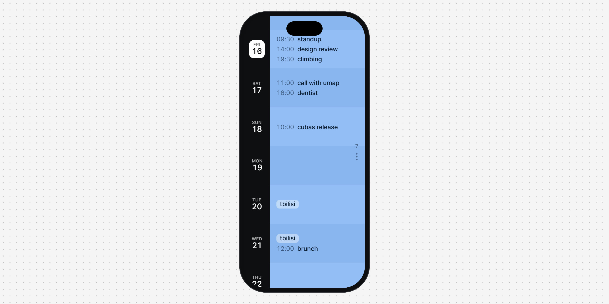
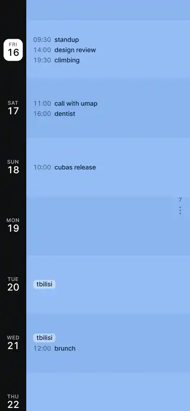

<p align="center">
  
</p>

<p align="center">
  <a href="https://likemiens.com/ui/pinch-calendar"><b>Live demo</b></a> ·
  <a href="media/demo.mp4"><b>Video</b></a> ·
  <a href="#quick-start"><b>Quick start</b></a>
</p>

<p align="center">
  Made by Likemiens ·
  <a href="https://x.com/a_varantsov">X</a> ·
  <a href="https://t.me/Likemiens">Telegram</a> ·
  <a href="https://github.com/Likemiens">GitHub</a>
</p>

**pinch-calendar** is a list of days you can pinch. Pinch the days apart, and fewer of them get more room. Pinch them together, and two weeks fit. When you let go, a spring settles the view on whole days.

It is one React component in two files, with nothing else to install. It works with fingers, a trackpad, a mouse and a keyboard. Inspired by the pinch-to-resize calendar in Timepage, as seen on [60fps.design](https://60fps.design).

<p align="center">
  
</p>

## Features

- **Follows your fingers.** The days resize smoothly around the pinch, and the day under your fingers stays under them.
- **Springs to whole days.** A quick pinch carries on a little. Past the limits, the days stretch like a rubber band and spring back.
- **Not only touch.** Trackpad pinch, Ctrl + wheel, a ⋮ grip you can drag, and keys.
- **Keeps its place.** A resize never moves the list, and a density set from your code keeps the top of the view.
- **Accessible.** Each day is read out with its weekday and date, today is marked, the grip is a real slider, and "reduce motion" is respected.

## Quick start

Copy `pinch-calendar.tsx` and `pinch-calendar.css` into your project, side by side. Or take the whole folder:

```bash
npx degit Likemiens/pinch-calendar components/pinch-calendar
```

Then put it in a parent that has a height:

```tsx
"use client";

import { useState } from "react";
import { PinchCalendar, type CalendarEvent } from "./pinch-calendar"; // brings pinch-calendar.css with it

const events: CalendarEvent[] = [
  { date: "2026-10-16", time: "09:30", title: "Standup" },
  { date: "2026-10-18", title: "Trip to Tbilisi" },
];

export function Agenda() {
  const [density, setDensity] = useState(7);
  return (
    <div style={{ height: 640 }}>
      <PinchCalendar
        from="2026-10-01"
        length={84}
        today="2026-10-16"
        density={density}
        onDensityChange={setDensity}
        events={events}
        locale="en"
        labels={{
          calendar: "Calendar",
          density: "Days in view",
          today: "Back to today",
          days: (count) => `${count} days`,
        }}
      />
    </div>
  );
}
```

> [!NOTE]
> It needs React 19.2 or newer and a bundler that imports CSS, such as Next.js or Vite.

Three things to keep in mind:

- **The parent needs a height.** The calendar fills it; under a parent without one it is 480 px tall.
- **Pass the density back as is.** `onDensityChange` fires on every frame of a pinch and of the spring. The value is fractional while it moves, so round it only to show it.
- **Dates are `YYYY-MM-DD`.** `today` is the viewer's local date. On a prerendered page, work it out in the browser: [example.tsx](example.tsx) shows how.

## Props

| Prop | Type | Default | What it does |
|---|---|---|---|
| `from` | `string` | required | The first day of the list, `YYYY-MM-DD` |
| `length` | `number` | required | How many days the list holds |
| `today` | `string` | required | The day on the white plate, `YYYY-MM-DD` |
| `density` | `number` | required | Days in view. Whole at rest, fractional while it moves |
| `onDensityChange` | `(density: number) => void` | required | Called on every frame of a pinch and of the spring. Pass the value back as is |
| `range` | `[number, number]` | `[3, 14]` | The fewest and the most days a gesture settles on |
| `events` | `CalendarEvent[]` | — | `{ date, time?, title }`. An event without `time` takes the whole day |
| `locale` | `string` | required | A language tag for the names of days and months: `en`, `de`, `ru`… |
| `labels` | `PinchCalendarLabels` | required | Words for screen readers: `calendar`, `density`, `today` and `days(count)` |
| `state` | `"pinch" \| "focus" \| "away"` | — | Shows a state without a hand, for previews and screenshots |

A taller day shows more events. `time` is shown before the title just as you write it, and events keep the order you pass them in. The props are typed as `PinchCalendarProps`, exported with the component.

## Gestures and keys

| Input | What happens |
|---|---|
| Pinch | The days follow your fingers, without steps |
| Let go | A spring settles the view on whole days |
| Pinch past a limit | The days stretch like a rubber band, then spring back |
| Trackpad pinch, Ctrl + wheel | The same on a computer |
| Drag the ⋮ grip | The same with one pointer. The top of the view holds |
| `+` / `-` | One day fewer / more, while the list has focus |
| `↑` / `↓` on the grip | One day more / fewer. `Page Up` / `Page Down`: three days. `Home` / `End`: the limits |
| Round button | Brings today back when it is out of view |

## Styling

Give the parent a class and set the variables on `.pc` inside it, so they win over the defaults:

```css
.agenda .pc {
  --pc-rail: #0e0f12;       /* the dark column of dates */
  --pc-rail-width: 54px;    /* its width */
  --pc-band: #93bdf5;       /* the days */
  --pc-band-alt: #8ab5f0;   /* every other day */
  --pc-ink: #0b1c33;        /* text on the days, and the grip */
  --pc-blue: #0c75f1;       /* focus rings */
  border-radius: 24px;      /* corners, if you want them */
}
```

The font comes from your page, or from `--ui-font` if you set it. `--pc-speed` (default `1`) scales the CSS transitions: `0.5` plays them at half speed, which helps when you record a preview.

## Files

```
pinch-calendar.tsx   the component
pinch-calendar.css   its styles, imported by the component
example.tsx          a full-height agenda that takes today from the browser
AGENTS.md            notes for coding agents
media/               the cover, the preview and the video
```

## Author

Made by **Likemiens**. Say hi or share what you built: [X](https://x.com/a_varantsov) · [Telegram](https://t.me/Likemiens) · [GitHub](https://github.com/Likemiens)

## License

[MIT](LICENSE) © Likemiens
